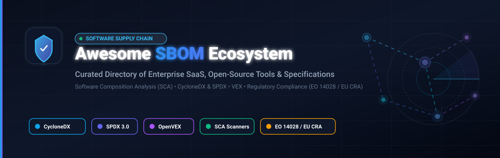

<p align="center">
  
</p>

# 🛡️ Awesome-Software-Bill-Of-Materials-SBOM

<p align="center">
  <a href="https://github.com/ishandutta2007/Awesome-Awesome-Awesome"></a><a href="https://discord.gg/jc4xtF58Ve"></a>
  <a href="https://github.com/ishandutta2007/Awesome-Software-Bill-Of-Materials-SBOM/stargazers"></a>
  <a href="https://github.com/ishandutta2007/Awesome-Software-Bill-Of-Materials-SBOM/network/members"></a>
  <a href="https://github.com/ishandutta2007/Awesome-Software-Bill-Of-Materials-SBOM/issues"></a>
  <a href="https://github.com/ishandutta2007/Awesome-Software-Bill-Of-Materials-SBOM/pulls"></a>
  <a href="https://github.com/ishandutta2007/Awesome-Software-Bill-Of-Materials-SBOM/blob/main/LICENSE"></a>
  <a href="https://github.com/ishandutta2007"></a>
</p>

---

## 🧭 Curated Guide to Software Bill of Materials (SBOM), SCA & Supply Chain Security

Welcome to the definitive, SEO-optimized directory and knowledge base for **Software Bill of Materials (SBOM)**, **Software Composition Analysis (SCA)**, **Software Supply Chain Security**, and vulnerability intelligence tooling. 

An **SBOM** is a formal, machine-readable inventory of software components, libraries, transitively nested dependencies, and license metadata that comprise an application. Driven by regulatory mandates such as **US Executive Order 14028**, the **EU Cyber Resilience Act (CRA)**, **NIST SP 800-218 (SSDF)**, and **FDA Premarket Cybersecurity Guidelines**, generating and managing spec-compliant SBOMs (**CycloneDX** and **SPDX**) paired with **VEX (Vulnerability Exploitability eXchange)** has transitioned from a best practice into an international compliance requirement.

This repository tracks top-tier enterprise SaaS platforms and battle-tested open-source projects, complete with concrete pricing tiers, trial parameters, valuation benchmarks, and stargazer counts.

---

## 📑 Table of Contents

- [🛡️ Awesome-Software-Bill-Of-Materials-SBOM](#️-awesome-software-bill-of-materials-sbom)
  - [🧭 Curated Guide to Software Bill of Materials (SBOM), SCA \& Supply Chain Security](#-curated-guide-to-software-bill-of-materials-sbom-sca--supply-chain-security)
  - [📑 Table of Contents](#-table-of-contents)
  - [📊 Sector Overview \& Market Dynamics](#-sector-overview--market-dynamics)
  - [💼 SaaS \& Enterprise Hosted Platforms](#-saas--enterprise-hosted-platforms)
    - [🏢 Deep Dives into Enterprise SaaS Platforms](#-deep-dives-into-enterprise-saas-platforms)
  - [⚡ Open-Source GitHub Projects](#-open-source-github-projects)
    - [📋 Open-Source Tool Ecosystem Summary](#-open-source-tool-ecosystem-summary)
    - [🔍 Detailed Open-Source Project Profiles](#-detailed-open-source-project-profiles)
  - [🏗️ Recommended SBOM Pipeline Architecture](#️-recommended-sbom-pipeline-architecture)
  - [📜 SBOM Formats \& Regulatory Standards](#-sbom-formats--regulatory-standards)
  - [🤝 How to Contribute](#-how-to-contribute)
  - [⚠️ Disclaimer](#️-disclaimer)
  - [📈 Star History](#-star-history)
  - [💖 Support \& Community](#-support--community)

---

## 📊 Sector Overview & Market Dynamics

The global **Software Supply Chain Security and SBOM market** was valued at approximately **$1.6 Billion in 2023** and is projected to surge to over **$6.8 Billion by 2030**, advancing at a compound annual growth rate (**CAGR of ~24.5%**). Growth is propelled by regulatory compliance enforcement (US EO 14028, CISA directives, EU CRA, and FDA medical device regulations), alongside high-profile software supply chain exploits (e.g., Log4Shell, SolarWinds, XZ Utils).

The sector is currently **moderately to highly fragmented** rather than a winner-take-all monopoly:
- **Developer-First Platforms** (e.g., Snyk, Mend.io) compete intensely on IDE integrations, CLI friction reduction, and automated pull requests.
- **Enterprise Governance & SCA Veterans** (e.g., Black Duck, Sonatype, Revenera) dominate Fortune 500 audit trails, legal license clearances, and air-gapped defense enclaves.
- **Cyber-Physical & Embedded Specialists** (e.g., Cybellum, Finite State) capture specialized niches across automotive, medical devices, and IoT firmware where source code is rarely available.
- **Open Standards Decoupling**: Because data structures are anchored in vendor-neutral open standards (**OWASP CycloneDX** and **Linux Foundation SPDX**), lock-in is constrained. Organizations routinely deploy hybrid architectures that pair open-source generators (Syft, Trivy) with centralized enterprise monitoring systems (Dependency-Track, Anchore).

---

## 💼 SaaS & Enterprise Hosted Platforms

The following table provides verified, transparent pricing models, trial boundaries, and corporate scale benchmarks (sorted descending by company revenue / valuation):

| 🏢 Platform / Vendor | 💰 Starting Pricing | ⏱️ Free Tier / Trial Limits | 📈 Company Scale (Valuation / Revenue) | 🎯 Core Focus & Compliance |
| :--- | :--- | :--- | :--- | :--- |
| **[Snyk](https://snyk.io/product/open-source-security/)** | **$25 / dev / month** *(Team plan, min. 5 devs = $125/mo)*; Enterprise tier starts at $98 / dev / month | **Free forever plan**: Up to 200 SCA / SBOM tests/month; **Unlimited tests** on public open-source repos | **$7.4B valuation** *(Peaked at $8.5B; $250M+ ARR)* | Developer-first SCA, `snyk sbom` CLI, SPDX/CycloneDX exports, automated PRs |
| **[Revenera FlexNet Code Insight](https://www.revenera.com/)** | **~$25,000 / year** *(Base enterprise license per application / codebase)* | **30-day guided Proof of Concept (POC)** trial for 1 target codebase *(No permanent free tier)* | **$3.5B+ valuation** *(Parent Flexera acquired by Thoma Bravo; $400M+ revenue)* | Comprehensive license compliance, NOTICE file automation, 14M+ OSS components |
| **[Black Duck](https://www.blackduck.com/)** | **~$50,000 / year** *(Base enterprise SCA license; scales by codebase count and developers)* | **30-day sales-assisted Proof of Concept (POC)** trial on 1–3 active codebases *(No permanent free tier)* | **$2.1B valuation** *(Acquired by Clearlake & Francisco Partners; ~$450M ARR)* | Enterprise SCA benchmark, snippet/binary scan, AI/ML model detection, EO 14028, FDA |
| **[Sonatype Lifecycle & SBOM Manager](https://www.sonatype.com/)** | **~$10,000 / year** *(Or ~$690 / developer / year entry tier via AWS Marketplace)* | **14-day guided sandbox / POC** evaluation *(Sonatype Nexus OSS has permanent free tier up to 40k components)* | **~$1.5B valuation** *(Backed by Vista Equity Partners; ~$150M+ ARR)* | System of record for components, SAGE air-gapped federal enclaves, policy-as-code |
| **[Mend.io](https://www.mend.io/)** | **$250 / dev / year** *(Renovate Enterprise)*; AppSec platform bundles up to **$1,000 / dev / year** | **Free forever plan**: Mend Renovate Community Edition capped at 10 repos; **14-day free trial** for AppSec SaaS | **~$500M valuation** *(Total funding $120M+; ~$100M+ ARR)* | AI Bill of Materials (AIBoM), automated dependency updates (Renovate), VEX reachability |
| **[Legit Security](https://www.legitsecurity.com/)** | **~$20,000 / year** *(Base ASPM & pipeline security subscription on AWS Marketplace)* | **14-day free trial** *(Access to secrets scanning and pipeline posture on up to 5 repos; no permanent free tier)* | **~$250M valuation** *(Series B $40M led by CRV; total funding $68M)* | Continuous compliance guardrails (ISO 27001, SSDF, FedRAMP, SLSA), signed attestations |
| **[Anchore Enterprise](https://anchore.com/)** | **$34,500 / year** *(AWS Marketplace 12-month baseline; includes 500 SBOM imports/month)* | **15-day AWS self-service free trial**; Syft & Grype open-source CLI tools are **Free forever** | **~$250M valuation** *(Total funding $50M+; backed by SignalFire & Insight Partners)* | Cloud-native container security, "Bring Your Own SBOM" validator, CVSS/EPSS scoring |
| **[Cybellum](https://cybellum.com/)** | **~$30,000 / year** *(Base product security tier for connected devices)* | **30-day guided Proof of Concept (POC)** trial on up to 2 firmware/binary images *(No permanent free tier)* | **$240M valuation** *(Acquired by LG Electronics)* | Cyber Digital Twins™ for automotive, medical, and IoT devices; product SBOM lifecycle |
| **[Finite State](https://finitestate.io/)** | **~$25,000 / year** *(Base product security OS tier for firmware and binary analysis)* | **14-day guided evaluation pilot** on up to 2 binary/firmware builds *(No permanent free tier)* | **~$180M valuation** *(Total funding $50M+; backed by Energy Impact Partners)* | IoT/embedded device firmware scanning (130+ binary formats), reachability with EPSS/KEV |
| **[FOSSA](https://fossa.com/)** | **$20 / project / month** *(Billed annually at $240/project/yr)*; Enterprise starts at **~$12,000 / year** | **Free forever plan**: Up to 5 projects / repositories and 25 contributing developers | **~$150M valuation** *(Series C; total funding $65M+)* | Automated NOTICE file recreation, FDA compliance, C/C++ native scanning, license risk |

---

### 🏢 Deep Dives into Enterprise SaaS Platforms

- 🦆 **[Black Duck](https://www.blackduck.com/)**  
  **The reference enterprise SCA and SBOM platform**, recognized as a Leader in the Gartner Magic Quadrant for Software Supply Chain Security. Imports third-party SBOMs and generates standard SPDX and CycloneDX documents containing open-source, proprietary, and commercial dependencies with configurable regulatory metadata. Advanced scan technologies combine package dependency inspection, CodePrint snippet matching, binary analysis, and container inspection. Detects malware via ReversingLabs threat intelligence and inventories integrated AI/ML models, origin checkpoints, and license obligations. Validated compliance mapping covers EO 14028, NTIA, FDA, NIST SSDF, and the EU Cyber Resilience Act.

- 📦 **[Sonatype Lifecycle & SBOM Manager](https://www.sonatype.com/)**  
  **The definitive enterprise system of record for software artifacts**, drawing on 15+ years of curated OSS intelligence from Maven Central and OSS Index. Features **SAGE (Sonatype Air-Gapped Environment)** to package Lifecycle, Nexus Repository, SBOM Manager, and Nexus Firewall for classified and fully disconnected environments (NIST SSDF, EO 14028, and CISA BOD 22-01). SBOM Manager generates SBOMs directly from binaries and container layers when source code is inaccessible, with real-time continuous monitoring against new CVEs, KEV items, and license changes.

- 🧠 **[Mend.io](https://www.mend.io/)**  
  **Unified application security and AI governance.** Pioneer in **AI Bill of Materials (AIBoM)**, extending traditional SBOM scopes by cataloging human-authored code, open-source libraries, AI-generated code, LLM models, MCPs, and shadow AI components into machine-readable SPDX and CycloneDX formats. Integrates reachability analysis and VEX data to filter false positives and power automated dependency upgrades via Mend Renovate.

- ⚡ **[Snyk Open Source](https://snyk.io/product/open-source-security/)**  
  **Developer-first SCA with native CLI and API-driven SBOM generation.** The `snyk sbom` command produces CycloneDX v1.4–1.6 (JSON/XML) and SPDX v2.3 (JSON) documents directly from manifest files. Flags include `--unmanaged` for scanning C/C++ projects without package managers, `--all-projects` for monorepo auto-discovery, and `--prune-repeated-subdependencies`. Snyk's REST APIs facilitate automated SBOM retrieval for continuously monitored repositories in CI/CD pipelines.

- ⚖️ **[FOSSA](https://fossa.com/)**  
  **Industry standard for open-source license compliance and automated NOTICE files.** Awarded top marks in license risk management by Forrester Wave. Features automated legal attribution generation, FDA compliance mapping, and deep C/C++ scanning with native SBOM generation. Designed for legal and compliance teams that require continuous obligations tracking alongside vulnerability management.

- 🔍 **[Revenera FlexNet Code Insight](https://www.revenera.com/)**  
  **Comprehensive open-source license compliance and dependency governance.** Backed by a component database of 14M+ items across 25+ programming languages and 70+ file extensions. Uncovers open-source fragments in source code, compiled binaries, Docker containers, and partial snippet matches. Offers customizable audit approval workflows and continuous vulnerability monitoring against Secunia Research and NVD feeds.

- ⚓ **[Anchore Enterprise](https://anchore.com/)**  
  **Cloud-native container security and SBOM management platform.** Anchore SBOM delivers centralized "Bring Your Own SBOM" capabilities, importing and validating external SBOMs in SPDX (2.1–2.3), CycloneDX (1.0–1.6), and Syft native formats. Anchore Score correlates CVSS, EPSS, and CISA KEV feeds to prioritize remediation for the US Navy, DoD, Cisco, and NVIDIA.

- 🛡️ **[Legit Security](https://www.legitsecurity.com/)**  
  **Continuous application security posture management (ASPM) and supply chain protection.** Enforces automated compliance guardrails aligned with ISO 27001, NIST SSDF, FedRAMP, SLSA, SOC 2, and CISA Attestation. Tracks pipeline tampering, produces cryptographically signed software attestations, and maintains dynamic SBOMs across CI/CD environments.

- 🚗 **[Cybellum](https://cybellum.com/)**  
  **Product security platform powered by Cyber Digital Twins™** for automotive, medical, and connected IoT manufacturers. Automates the ingestion, validation, merging, and lifecycle monitoring of product SBOMs across multi-tier supplier ecosystems, with turnkey mappings to over 50 international product security standards.

- 🔬 **[Finite State](https://finitestate.io/)**  
  **Binary-first product security OS for connected devices and embedded firmware.** Ingests and inspects 130+ binary formats across 30+ hardware architectures without source code requirements. Consolidates multi-tier supplier SBOMs into a single pane of glass, applying reachability analysis, EPSS scoring, and CISA KEV intelligence to eliminate unreachable vulnerability noise.

---

## ⚡ Open-Source GitHub Projects

Explore the leading open-source SBOM generators, validators, scanners, and graph engines. **Sorted in descending order by GitHub Stargazer count**:

### 📋 Open-Source Tool Ecosystem Summary

| 🛠️ Project | 🌟 GitHub_Stars | 📦 Primary Formats | 🔧 Implementation | 💡 Primary Use Case |
| :--- | :---: | :--- | :--- | :--- |
| **[Trivy](https://github.com/aquasecurity/trivy)** | [](https://github.com/aquasecurity/trivy/stargazers) | CycloneDX, SPDX | Go | All-in-one container, filesystem, and K8s vulnerability scanner & SBOM generator |
| **[Grype](https://github.com/anchore/grype)** | [](https://github.com/anchore/grype/stargazers) | CycloneDX, Syft JSON | Go | Fast vulnerability scanner for container images, filesystems, and existing SBOMs |
| **[OSV-Scanner](https://github.com/google/osv-scanner)** | [](https://github.com/google/osv-scanner/stargazers) | CycloneDX, SPDX, OSV | Go | Google's vulnerability scanner pairing SBOMs with the distributed OSV database |
| **[Syft](https://github.com/anchore/syft)** | [](https://github.com/anchore/syft/stargazers) | CycloneDX, SPDX, Syft JSON | Go | Dedicated, multi-ecosystem CLI tool for generating spec-compliant SBOMs |
| **[Cosign / Sigstore](https://github.com/sigstore/cosign)** | [](https://github.com/sigstore/cosign/stargazers) | In-toto, SPDX, CycloneDX | Go | Container signing, cryptographic attestation, and provenance verification |
| **[Dependency-Track](https://github.com/DependencyTrack/dependency-track)** | [](https://github.com/DependencyTrack/dependency-track/stargazers) | CycloneDX, SPDX, VEX | Java / TypeScript | Intelligent Component Analysis platform for continuous SBOM tracking & policy |
| **[Microsoft sbom-tool](https://github.com/microsoft/sbom-tool)** | [](https://github.com/microsoft/sbom-tool/stargazers) | SPDX 2.2 | C# / .NET | Enterprise-scale, cross-platform CLI tool for generating build and CI SPDX SBOMs |
| **[GUAC](https://github.com/guacsec/guac)** | [](https://github.com/guacsec/guac/stargazers) | CycloneDX, SPDX, SLSA | Go / GraphQL | Graph database for synthesizing SBOMs, attestations, and supply chain intelligence |
| **[cdxgen](https://github.com/CycloneDX/cdxgen)** | [](https://github.com/CycloneDX/cdxgen/stargazers) | CycloneDX 1.4–1.6, VEX | JavaScript / Node.js | Official CycloneDX multi-language SBOM and VEX generator with broad language coverage |
| **[in-toto](https://github.com/in-toto/in-toto)** | [](https://github.com/in-toto/in-toto/stargazers) | In-toto Attestations | Python / Go | Cryptographic framework verifying every step of software supply chain integrity |
| **[FOSSology](https://github.com/fossology/fossology)** | [](https://github.com/fossology/fossology/stargazers) | SPDX 2.x | PHP / C++ / C | Open source license compliance toolkit, copyright scanner, and SPDX generator |
| **[Tern](https://github.com/tern-tools/tern)** | [](https://github.com/tern-tools/tern/stargazers) | SPDX, JSON, HTML | Python | Layer-by-layer container inspection and license provenance SBOM generator |
| **[Melange](https://github.com/chainguard-dev/melange)** | [](https://github.com/chainguard-dev/melange/stargazers) | SPDX 2.3 | Go | Declarative, minimal APK package builder with automated built-in SBOM generation |
| **[Kubernetes bom](https://github.com/kubernetes-sigs/bom)** | [](https://github.com/kubernetes-sigs/bom/stargazers) | SPDX 2.3 | Go | Kubernetes SIG Release utility to generate, query, and validate SPDX SBOMs |
| **[spdx-sbom-generator](https://github.com/spdx/spdx-sbom-generator)** | [](https://github.com/spdx/spdx-sbom-generator/stargazers) | SPDX 2.2 | Go | Standalone CLI generating SPDX SBOMs for multi-language package managers |
| **[sbomqs](https://github.com/interlynk-io/sbomqs)** | [](https://github.com/interlynk-io/sbomqs/stargazers) | CycloneDX, SPDX | Go | Quality and compliance scoring engine testing SBOMs against NTIA and CISA criteria |
| **[spdx/tools-golang](https://github.com/spdx/tools-golang)** | [](https://github.com/spdx/tools-golang/stargazers) | SPDX 2.2, 2.3, 3.0 | Go | Official SPDX Go libraries and CLI tools for parsing, generating, and validating |
| **[sbomasm](https://github.com/interlynk-io/sbomasm)** | [](https://github.com/interlynk-io/sbomasm/stargazers) | CycloneDX, SPDX | Go | Assembler tool to merge, filter, edit, and stitch composite SBOM documents |
| **[OpenVEX (vex)](https://github.com/openvex/vex)** | [](https://github.com/openvex/vex/stargazers) | OpenVEX JSON-LD | Go | Open specification and tooling for Vulnerability Exploitability eXchange data |

---

### 🔍 Detailed Open-Source Project Profiles

1. **[Trivy](https://github.com/aquasecurity/trivy)** [](https://github.com/aquasecurity/trivy/stargazers)  
   **The comprehensive open-source security scanner with built-in SBOM generation.** Maintained by Aqua Security, Trivy scans container images, filesystems, Git repositories, virtual machine images, and Kubernetes manifests. It exports CycloneDX (JSON/XML) and SPDX (JSON) documents directly: `trivy image --format cyclonedx --output sbom.cdx.json <image>`. Ideal for teams seeking an all-in-one vulnerability scanner and SBOM generator within CI/CD pipelines.

2. **[Grype](https://github.com/anchore/grype)** [](https://github.com/anchore/grype/stargazers)  
   **Anchore's high-speed vulnerability scanner built for container images and SBOM files.** Grype seamlessly consumes SBOMs produced by Syft or other tools (`grype sbom:./sbom.spdx.json`), comparing components against up-to-date vulnerability feeds from Alpine, Red Hat, Debian, Ubuntu, GitHub Security Advisories, and NVD. Supports VEX suppression and integrates directly into GitHub Actions.

3. **[OSV-Scanner](https://github.com/google/osv-scanner)** [](https://github.com/google/osv-scanner/stargazers)  
   **Google's vulnerability scanner powered by the Open Source Vulnerabilities (OSV) database.** OSV-Scanner directly ingests SPDX and CycloneDX SBOMs to evaluate dependencies against the open, distributed OSV.dev schema. Delivers granular CVE, GHSA, and commit-level exploitability matching with minimal false positives.

4. **[Syft](https://github.com/anchore/syft)** [](https://github.com/anchore/syft/stargazers)  
   **The premier open-source SBOM generator for container images and filesystems.** Apache 2.0 licensed and maintained by Anchore, Syft inspects package manager databases (apt, apk, rpm), language ecosystems (Go, Rust, Python, Node, Java, Ruby, .NET), and archive formats. Directly generates standard CycloneDX 1.2–1.6, SPDX 2.2–3.0, and native JSON formats with a single command: `syft <image-or-dir> -o cyclonedx-json=sbom.json`.

5. **[Cosign / Sigstore](https://github.com/sigstore/cosign)** [](https://github.com/sigstore/cosign/stargazers)  
   **Container signing, cryptographic attestation, and supply chain provenance verification.** Part of the Linux Foundation's Sigstore project, Cosign allows developers to sign container images and attach SBOMs as signed in-toto attestations (`cosign attest --predicate sbom.json --type spdx <image>`). Establishes a verifiable chain of custody in OCI registries.

6. **[Dependency-Track](https://github.com/DependencyTrack/dependency-track)** [](https://github.com/DependencyTrack/dependency-track/stargazers)  
   **Intelligent Component Analysis platform for continuous SBOM management.** An OWASP flagship project, Dependency-Track consumes CycloneDX SBOMs at build time and continuously monitors component health against vulnerabilities, policy violations, and license risks. Integrates with NVD, GitHub Advisories, Sonatype OSS Index, and Snyk, providing comprehensive executive dashboards and automated VEX notifications.

7. **[Microsoft sbom-tool](https://github.com/microsoft/sbom-tool)** [](https://github.com/microsoft/sbom-tool/stargazers)  
   **Microsoft's highly scalable, cross-platform CLI for creating SPDX 2.2 compatible SBOMs.** Powers internal SBOM generation at Microsoft across thousands of repositories and build systems. Automatically detects dependencies, generates SHA256 package hashes, and packages standard SPDX documents for compliance with US Executive Order 14028.

8. **[GUAC (Graph for Understanding Artifact Composition)](https://github.com/guacsec/guac)** [](https://github.com/guacsec/guac/stargazers)  
   **Open-source supply chain knowledge graph backed by Google, Kusari, and Purdue.** GUAC ingests disparate SBOMs, SLSA attestations, Scorecards results, and OSV feeds into a unified graph database. Allows security teams to trace transitive dependencies, determine blast radiuses of newly disclosed zero-days, and query supply chain relationships via GraphQL.

9. **[cdxgen](https://github.com/CycloneDX/cdxgen)** [](https://github.com/CycloneDX/cdxgen/stargazers)  
   **The reference implementation SBOM generator maintained by the CycloneDX project.** Supports over 30+ programming language ecosystems, container images, build tools, and binary frameworks. Produces spec-compliant CycloneDX 1.4–1.6 documents with deep formulation, dependency graphs, services, and automated VEX generation.

10. **[in-toto](https://github.com/in-toto/in-toto)** [](https://github.com/in-toto/in-toto/stargazers)  
    **CNCF graduating framework for cryptographic supply chain integrity.** in-toto verifies every step of the software development lifecycle — from Git commits and code review to compiling and packaging. Provides metadata envelopes that bind SBOMs and build artifacts into tamper-proof verification policies.

11. **[FOSSology](https://github.com/fossology/fossology)** [](https://github.com/fossology/fossology/stargazers)  
    **Open-source license compliance toolkit and copyright scanner.** Runs automated license scanners (Nomos, Monk) on codebases, identifies licensing obligations, and exports standardized SPDX tag-value and RDF/XML documents. A foundational tool for open-source program offices (OSPOs) managing IP compliance.

12. **[Tern](https://github.com/tern-tools/tern)** [](https://github.com/tern-tools/tern/stargazers)  
    **Container image inspection tool providing layer-by-layer SBOM transparency.** Tern unpacks each layer of a Docker/OCI image to determine what packages were installed by specific Dockerfile commands, generating SPDX documents that delineate exactly which image layer introduced each component.

13. **[Melange](https://github.com/chainguard-dev/melange)** [](https://github.com/chainguard-dev/melange/stargazers)  
    **Chainguard's declarative APK package builder.** Designed for building secure, minimal container images (such as Wolfi and Chainguard Images), Melange automatically produces cryptographically verifiable SPDX 2.3 SBOMs alongside binary APK packages at build time.

14. **[Kubernetes bom](https://github.com/kubernetes-sigs/bom)** [](https://github.com/kubernetes-sigs/bom/stargazers)  
    **Kubernetes SIG Release tool for creating, examining, and validating SPDX SBOMs.** Used by the Kubernetes release team to generate official SBOMs for Kubernetes core releases. Generates complete SPDX 2.3 manifests for Git repositories, local directories, container images, and multi-architecture tarballs.

15. **[spdx-sbom-generator](https://github.com/spdx/spdx-sbom-generator)** [](https://github.com/spdx/spdx-sbom-generator/stargazers)  
    **Standalone CLI tool sponsored by the SPDX project for generating SPDX 2.2 documents.** Supports automated dependency detection across package managers for Go, Java (Maven/Gradle), JavaScript (npm/yarn), Python (pip), Rust (cargo), .NET, PHP, and Ruby.

16. **[sbomqs](https://github.com/interlynk-io/sbomqs)** [](https://github.com/interlynk-io/sbomqs/stargazers)  
    **Quality and compliance scoring engine for SBOMs.** Evaluates CycloneDX and SPDX files against NTIA Minimum Elements, BSI standards, and CISA guidance, assigning a quality score (0–10) with actionable diagnostics to improve SBOM completeness and fidelity.

17. **[spdx/tools-golang](https://github.com/spdx/tools-golang)** [](https://github.com/spdx/tools-golang/stargazers)  
    **The official SPDX Go library and CLI suite.** Maintained by the Linux Foundation SPDX working group, it provides developers with native Go primitives to read, write, parse, and validate SPDX documents across versions 2.2, 2.3, and 3.0.

18. **[sbomasm](https://github.com/interlynk-io/sbomasm)** [](https://github.com/interlynk-io/sbomasm/stargazers)  
    **The SBOM Assembler.** A utility to merge, edit, filter, and stitch together multiple disparate CycloneDX and SPDX SBOMs into a coherent, primary root SBOM document representing a complex composite system.

19. **[OpenVEX (vex)](https://github.com/openvex/vex)** [](https://github.com/openvex/vex/stargazers)  
    **Open specification and tooling for Vulnerability Exploitability eXchange (VEX).** Enables software publishers to publish machine-readable assertions indicating whether a vulnerability in an included SBOM component is actually exploitable within the product context, drastically reducing remediation noise.

---

## 🏗️ Recommended SBOM Pipeline Architecture

A resilient, spec-compliant software supply chain pipeline combines specialized tools across five stages:

```
┌─────────────────┐       ┌─────────────────┐       ┌─────────────────┐
│   Source / CI   │ ────> │ SBOM Generation │ ────> │  Attestation &  │
│   Build Phase   │       │ (Syft / cdxgen) │       │ Signing (Cosign)│
└─────────────────┘       └─────────────────┘       └─────────────────┘
                                                              │
                                                              ▼
┌─────────────────┐       ┌─────────────────┐       ┌─────────────────┐
│   Continuous    │ <──── │ Quality Scoring │ <──── │ Policy & Graph  │
│   VEX Response  │       │    (sbomqs)     │       │ (DependencyTrack│
│   (OpenVEX)     │       │                 │       │    / GUAC)      │
└─────────────────┘       └─────────────────┘       └─────────────────┘
```

1. **Generation**: Use **Syft** or **cdxgen** in your CI/CD runner to output SPDX 2.3 or CycloneDX 1.6 JSON manifests.
2. **Provenance & Attestation**: Sign the generated SBOM using **Cosign** and store it as an OCI artifact in your private registry.
3. **Quality Validation**: Run **sbomqs** to verify compliance against the NTIA Minimum Elements and EU CRA requirements before artifact release.
4. **Continuous Analysis**: Ingest the SBOM into **Dependency-Track** or **GUAC** for automated CVE correlation, license compliance, and policy gating.
5. **Exploitability Communication**: Publish an **OpenVEX** document asserting whether flagged vulnerabilities are reachable in your production configuration.

---

## 📜 SBOM Formats & Regulatory Standards

- **[OWASP CycloneDX](https://cyclonedx.org/)**: Built specifically for application security, dependency analysis, and software supply chain risks. Supports hardware (HBOM), AI models (AIBoM), operations (OBOM), and integrated VEX disclosures.
- **[Linux Foundation SPDX (ISO/IEC 5962:2021)](https://spdx.dev/)**: The international standard for software package data, intellectual property, and licensing metadata, updated for modular supply chain architectures in SPDX 3.0.
- **[CISA Vulnerability Exploitability eXchange (VEX)](https://www.cisa.gov/resources-tools/resources/vulnerability-exploitability-exchange-vex)**: Companion specification clarifying whether a discovered CVE actually impacts the host application (`not_affected`, `affected`, `fixed`, `under_investigation`).
- **[US Executive Order 14028 / NTIA Minimum Elements](https://www.cisa.gov/sbom)**: Mandates supplier name, component name, version string, unique identifiers (PURL / CPE), dependency relationships, author of metadata, and timestamp.
- **[EU Cyber Resilience Act (CRA)](https://digital-strategy.ec.europa.eu/en/policies/cyber-resilience-act)**: European Union regulation mandating SBOM documentation and automated vulnerability disclosures for all hardware and software products sold in the EU market.

---

## 🤝 How to Contribute

Contributions to keep this ecosystem directory current, factual, and exhaustive are warmly welcomed!

1. **Fork the repository** on GitHub.
2. **Add or edit entries** in `README.md` following the tabular and profile formats.
3. **Ensure strict data accuracy**: Include specific starting prices, explicit free tier or trial parameters, and direct links to official documentation.
4. **Submit a Pull Request** with a concise description of your additions.

---

## ⚠️ Disclaimer

- This repository is a **community-curated index** created for educational, research, and engineering reference purposes. It does not constitute formal legal counsel or vendor endorsement.
- Enterprise subscription pricing, cloud marketplace rates, and trial terms are subject to change by respective vendors. Always verify current commercial terms directly with vendor procurement teams.
- Self-hosted open-source tooling requires proper infrastructure hardening, continuous vulnerability database sync, and validation against your specific security threat model.

---

## 📈 Star History

[](https://star-history.dera.page/#ishandutta2007/Awesome-Software-Bill-Of-Materials-SBOM&type=date&legend=top-left)

---

## 💖 Support & Community

Thank you for exploring and bookmarking **Awesome-Software-Bill-Of-Materials-SBOM**! If you find this directory valuable for your organization, DevSecOps pipelines, or security research, here is how you can support our continued curation:

- ⭐ **Star this repository** to improve visibility and help other security teams discover it.
- 🍴 **Fork and contribute** by submitting a PR to add or update tools and emerging standards.
- 📢 **Share with colleagues** in your DevSecOps, AppSec, and open-source communities.
- ☕ **Buy a Coffee / Sponsor**: Support ongoing maintenance, research, and curation through our [GitHub Sponsor Dashboard](https://github.com/sponsors/ishandutta2007).

<p align="center">
  <a href="https://github.com/sponsors/ishandutta2007">
    
  </a>
</p>

---

<p align="center">
  <b>Curated with care for security engineers, DevSecOps teams, OSPO directors, and software architects worldwide. 🛡️✨</b>
</p>
# Awesome-Software-Bill-Of-Materials-SBOM

## Top Software Bill of Materials (SBOM) Tools Ecosystem

**Curated List of SaaS Products & Open-Source GitHub Projects**  
*Focused on Software Composition Analysis, CycloneDX/SPDX Generation & Vulnerability Intelligence*  
**Last updated: March 2026**

This repository tracks notable **SaaS platforms** and **open-source projects** for **Software Bill of Materials (SBOM)**. These tools generate, manage, and analyze SBOMs — machine-readable inventories of software components, dependencies, and licenses — enabling organizations to understand their supply chain, respond to vulnerabilities, and meet regulatory requirements like EO 14028 and the EU Cyber Resilience Act.

**Examples** include Black Duck, Sonatype Lifecycle, Mend.io, Snyk Open Source, FOSSA, Revenera FlexNet, Anchore Enterprise, Cybellum, Finite State, and Legit Security (the category leaders).

**Open-source emphasis**: This section is heavily expanded with every major active project for self-hosting, spec-compliant SBOM generation, and transparent dependency analysis — ideal for security teams prioritizing data sovereignty, developers building supply chain pipelines, and organizations that need verifiable evidence without relying solely on commercial SaaS platforms.

Contributions welcome! Open a PR to add/update entries. Keep descriptions factual and link to official sites.

## Table of Contents
- [SaaS/Hosted Platforms](#saas-hosted-platforms)
- [Open-Source GitHub Projects](#open-source-github-projects)
- [How to Contribute](#how-to-contribute)
- [Disclaimer](#disclaimer)

## SaaS/Hosted Platforms

- **[Black Duck (Synopsys)](https://www.blackduck.com/)**  
  **The reference enterprise SCA and SBOM platform**, named a Leader in the **2026 Gartner Magic Quadrant for Software Supply Chain Security**. **Import third-party SBOMs and generate SPDX and CycloneDX SBOMs** containing open source, proprietary, and commercial dependencies with customizable fields for industry, regulatory, or customer requirements. **Multiple scan technologies** combine package dependencies, CodePrint, snippet, binary, and container analysis to identify components in any programming language. **Malware detection** via ReversingLabs technology detects suspicious files and malicious packages post-build. **AI/ML model detection** uncovers integrated AI models, their origin, license obligations, and whether they've been significantly retrained. **Regulatory alignment** covers EO 14028, NTIA, FDA, SSDF, and EU CRA. **Gartner Peer Insights reviewers** praise comprehensive SBOM generation and enterprise integration.

- **[Sonatype Lifecycle & SBOM Manager](https://www.sonatype.com/)**  
  **The system of record for software artifacts** built on 15+ years of curated OSS intelligence from Maven Central and OSS Index. **SAGE (Sonatype Air-Gapped Environment)** packages Lifecycle, Nexus Repository, SBOM Manager, and Nexus Firewall with SAGE Data Services for **fully disconnected federal environments** — no external network calls, continuous compliance with NIST SSDF, EO 14028, and CISA BOD 22-01. **SBOM Manager** generates SBOMs directly from binaries and container images, critical when source code is unavailable, and continuously monitors them against new CVEs, KEV items, and license changes. **Central Mirror** provides a point-in-time snapshot of Maven Central for high-throughput builds entirely within the enclave. **Policy-as-code governance** enforces KEV-aware prioritization, license compliance, and security risk thresholds directly in CI/CD pipelines. **The air-gapped choice for defense, intelligence, and federal civilian programs**.

- **[Mend.io](https://www.mend.io/)**  
  **Unified governance for the software you write and the AI you build.** **Mend AI** provides **AI Bill of Materials (AIBoM)** — goes beyond traditional SBOM by scanning **human-written and AI-generated code, open source libraries, and proprietary components** into a comprehensive machine-readable inventory in SPDX and CycloneDX formats. **AI component detection** covers models, frameworks, agents, RAGs, MCPs, and shadow AI. **System prompt hardening** detects and assesses system prompts against best practices. **AI red teaming** uses prebuilt and custom tests across prompt injection, hallucination, and social engineering. **Reachability analysis** with VEX data identifies whether application code can reach vulnerable components. **Automated dependency updates** keep SBOMs continuously current as components change. **VEX incorporation** adds exploitability context to each component automatically. **Regulatory alignment** covers EO 14028, EU CRA, and CISA submission. **The AI-native choice** for organizations building with or on AI models.

- **[Snyk Open Source](https://snyk.io/product/open-source-security/)**  
  **Developer-first SCA with CLI and API-driven SBOM generation.** The **`snyk sbom` command** generates CycloneDX v1.4-1.6 (JSON/XML) and SPDX v2.3 (JSON) documents from package manager manifests. **`--unmanaged`** generates SBOMs for projects without manifest files. **`--all-projects`** auto-detects all projects in monorepos and produces a single SBOM. **`--dev`** includes development-only dependencies. **`--prune-repeated-subdependencies`** removes duplicate sub-dependencies. **`--allow-incomplete-sbom`** continues generation when some projects fail to resolve. **Snyk REST API** endpoint retrieves SBOM documents for continuously monitored projects with Snyk-specific metadata including org, project, and target IDs. **Best for developer-first workflows** wanting SBOM generation as part of the normal CLI and CI experience.

- **[FOSSA](https://fossa.com/)**  
  **Recognized as a significant SCA solution in The Forrester Wave™**, achieving **highest scores in license risk management and SBOM criteria**. **Automated NOTICE file recreation** and **FDA compliance support**. **SBOM policy feature** enforces SBOM standards for compliance and security. **C/C++ scanning and SBOM generation** support enhances software supply chain security for systems programming. **Best for license-compliance-heavy organizations** where NOTICE files and obligations management matter.

- **[Revenera FlexNet Code Insight](https://www.revenera.com/)**  
  **Single integrated solution for open source license compliance and security.** **14 million+ components** with support for **25+ languages and 70+ extensions**. **Vulnerability data from multiple sources** including NVD and Secunia Research. **Discovers all open source in source code, binaries, containers, build dependencies, subcomponents, modified and partial open source components**. **Patented scan and analysis flexibility** for varying business needs. **Policy enforcement and approval automation** with usage and remediation guidance. **Proactive and continuous monitoring** of newly discovered vulnerabilities in current and shipped products. **REST API framework** for custom integrations with build tools, CI/CD, SCM, and artifact repositories. **Best for organizations needing deep license obligation management** alongside security.

- **[Anchore Enterprise](https://anchore.com/)**  
  **Market leader in SCA for cloud-native platforms** with **Anchore SBOM** providing centralized SBOM management including **"Bring Your Own SBOMs"**. **Imports SBOMs in SPDX (2.1-2.3), CycloneDX (1.0-1.6), and Syft native formats**. **Validates uploaded SBOM quality** against schema standards. **Anchore Score** prioritizes vulnerabilities based on CVSS, EPSS, and CISA KEV data. **Flagship customers include NVIDIA, Cisco, US Navy, and Department of Defense**. **Best for container and cloud-native security** with existing Anchore deployments.

- **[Legit Security](https://www.legitsecurity.com/)**  
  **Continuous compliance and SBOM with alignment to regulatory frameworks.** **Maps security guardrails to specific regulations** including ISO 27001, SSDF, FedRAMP, SLSA, NIST, SOC 2, PCI DSS, and CISA Attestation. **Real-time compliance violation monitoring** with automated reporting. **Creates SBOMs and signed software attestations** in all regulated formats. **Best for organizations needing continuous compliance evidence** rather than point-in-time SBOM exports.

- **[Cybellum](https://cybellum.com/)**  
  **Product security platform with Cyber Digital Twins™** for connected device manufacturers. **Product SBOM management** orchestrates the entire SBOM process from merging to validation to collaboration. **Automotive, medical, and industrial sector focus** with pre-built mapping to **50+ standards**. **FDA compliance support** for medical device SBOM validation. **Best for embedded, IoT, and connected device manufacturers**.

- **[Finite State](https://finitestate.io/)**  
  **AI-first product security platform purpose-built for connected device manufacturers.** **Scans source code, binaries, third-party components, and firmware** from one platform. **130+ binary formats, 30+ architectures, 18+ programming languages**. **Consolidates third-party and legacy supplier SBOMs** into a single source of truth. **Reachability analysis** pinpoints truly exploitable vulnerabilities. **Prioritization based on EPSS, KEV, network exposure, exploit maturity, and license risk** with auto-resolution of unreachable findings. **Best for IoT and embedded systems** with complex binary and firmware analysis needs.

## Open-Source GitHub Projects

- **[Syft (Anchore)](https://github.com/anchore/syft)**  
  **One of the most widely deployed open-source SBOM generators** — Apache 2.0 licensed, 5,000+ GitHub stars. **Scans container images, filesystems, and archives** with broad ecosystem coverage across dozens of language ecosystems and OS package managers (apt, apk, rpm). **Generates both SPDX and CycloneDX output** out of the box — CycloneDX 1.2-1.7 (JSON/XML) and SPDX 2.2-3.0 (JSON) and SPDX tag-value 2.1-2.3. **Integrates cleanly with Grype** (Anchore's vulnerability scanner) and standard CI pipelines via a well-maintained GitHub Action. **`syft <image> -o <format>`** specifies output format and version. **Best for teams wanting a dedicated SBOM generator** with strong multi-ecosystem coverage and Anchore's backing.

- **[Trivy (Aqua Security)](https://github.com/aquasecurity/trivy)**  
  **Vulnerability scanner that grew into a capable SBOM generator** — supports both CycloneDX and SPDX for container images, filesystems, and Kubernetes clusters. **Because vulnerability scanning and SBOM generation share the same package-detection engine**, Trivy is practical for teams wanting one tool doing both jobs rather than stitching two together. **Fast, very active development, large user base**. **SBOM output is somewhat secondary to its scanning mission**, so some CycloneDX/SPDX edge-case fields and metadata completeness lag behind tools built primarily as SBOM generators. **Best for teams already using Trivy for scanning** who want SBOM generation without adding another tool.

- **[cdxgen (CycloneDX)](https://github.com/CycloneDX/cdxgen)**  
  **Dedicated CycloneDX generator** maintained under the CycloneDX project umbrella with **unusually broad language support**. **The reference implementation for CycloneDX format** from the project that maintains the specification. **Best for teams committed to CycloneDX** wanting a generator from the specification maintainers.

- **[Microsoft sbom-tool](https://github.com/microsoft/sbom-tool)**  
  **Microsoft's open-source SBOM generator** supporting SPDX format for source and build artifacts. **Best for .NET and Microsoft-centric development environments**.

- **[SPDX Tools](https://github.com/spdx/tools-golang)**  
  **Official SPDX tools** for generating, validating, and manipulating SPDX documents. **Best for teams needing strict SPDX compliance**.

- **[Tern](https://github.com/tern-tools/tern)**  
  **Software composition analysis tool and Python library** that generates SBOMs for container images and Dockerfiles. **Layer-by-layer view of container contents** in human-readable, JSON, HTML, and SPDX formats. **Best for container-focused SBOM generation** with a focus on layer transparency.

### Additional Strong Open-Source Options

- **Grype** — Anchore's vulnerability scanner that pairs with Syft SBOMs for continuous monitoring.
- **Dependency-Track** — Open-source SBOM analysis platform that consumes SBOMs and continuously monitors components for vulnerabilities with policy enforcement and license compliance.
- **OpenVEX** — Vulnerability Exploitability eXchange specification and tooling for machine-readable exploitability assessments that complement SBOMs.
- **Sigstore** — Digital signing and verification for software artifacts, providing the provenance layer that makes SBOMs verifiable.

**Frameworks for building custom systems**: Combine **Syft** for spec-compliant SBOM generation from containers and filesystems, **Trivy** for unified vulnerability scanning and SBOM output, **cdxgen** for dedicated CycloneDX generation with broad language support, **Dependency-Track** for continuous SBOM-based monitoring, and **Sigstore** for artifact signing and provenance verification — to build a complete self-hosted SBOM pipeline from generation through continuous monitoring and signed attestation.

## How to Contribute

1. Fork the repo.
2. Add/edit entries in `README.md` (follow existing format).
3. Include: name, link, 1–2 sentence description, and whether it's SaaS or open-source.
4. Submit PR with a short explanation.

Star the repo if you find it useful!

## Disclaimer

- This is a **community-curated** list — not exhaustive and not an endorsement.
- SBOM tools differ significantly in format support, ecosystem coverage, and deployment constraints. **Syft and Trivy are the most widely deployed open-source generators** with dual CycloneDX and SPDX support. **Trivy's SBOM output is secondary to its scanning mission** — edge-case metadata completeness may lag dedicated generators. **Sonatype SAGE is the only offering with a fully air-gapped architecture** for classified environments. **Mend's AIBoM and Black Duck's AI model detection** address the emerging need to inventory AI/ML components. **License compliance tools like FOSSA and Revenera** excel at NOTICE file generation and obligation tracking beyond basic SBOM generation. **Anchore's "Bring Your Own SBOM"** imports and validates third-party SBOMs in SPDX 2.1-2.3 and CycloneDX 1.0-1.6.
- Self-hosted open-source solutions require proper integration with existing CI/CD pipelines, vulnerability database updates, and ongoing monitoring of SBOM quality and completeness.

---

**Made for security engineers, DevSecOps teams, supply chain architects, and developers building SBOM and software composition analysis platforms.**  
Let's make software bill of materials more open, spec-compliant, and actionable.
